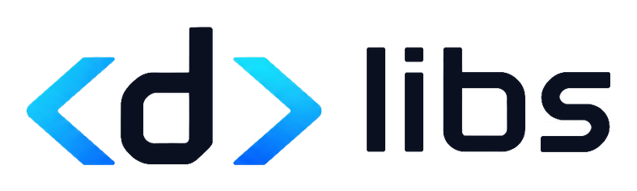

<p align="center">
  <picture>
    <source media="(prefers-color-scheme: dark)" srcset="assets/libs-dark.png">
    
  </picture>
</p>

---

**libs** is the package manager of the [dcode](https://github.com/ncode-sh/dcode)
programming language: what cargo is to Rust and Homebrew is to macOS.

> **Status: planned.** There is nothing to install yet. This repository holds
> the design and, later, the registry of approved packages. The dcode
> repository is private for now.

## What it does

```
libs                          # the libs of the app, with their versions
libs add python.pandas        # adds it to dcode.toml and dcode.lock
libs add python.pandas@2.1    # an exact version
libs remove python.pandas
libs update                   # every lib, to its newest approved version
libs update python.pandas     # only that one
```

`dcode libs add python.pandas` does the same. `dcode update` updates dcode
itself, never the libs of an app.

There is no separate download step: before an app runs, dcode downloads
whatever its `dcode.lock` names and is missing.

## Only approved packages

Anyone can publish to npm or PyPI, and both have served malicious and
hijacked packages. libs works as Homebrew does: a package, and each of its
versions, is reviewed before it enters the registry.

- The registry keeps one file per package and version: where it comes from,
  its hash and its tests.
- `dcode.lock` keeps the hash of every lib. A download that does not match it
  is refused, so a package can't change after it was approved.
- Code that is not in the registry runs as a separate program, with its data
  crossing as text or JSON.

## Libraries of other languages

The language comes first, in `libs` and in the code alike:

```
libs add python.pandas    ->   use python.pandas as pd
libs add c.sqlite         ->   use c.sqlite
libs add rates            ->   use rates        (the libs of dcode take no prefix)
```

dcode counts positions from 1; Python and C count them from 0. A package of
another language carries, for each of its versions, a layer that marks which
values its functions take or give are positions, so that in a dcode file
everything counts from 1:

```dcode
use python.numpy as np

a = np.array([5, 9, 2])
print(np.argmax(a))       -- 2: the 9 is the second
print(np.sum(a))          -- 16: a quantity, left as it is
```

## dcode.toml

```toml
[app]
name = "shop"
ver = "1.0.0"

[libs]
python.pandas = "2.2"
rates = "1.2"
```

## Where libs are kept

Downloaded libs never live in the project. They go to one cache per machine,
split by language and version, as Go and Rust do:

```
~/.dcode/
├── dc/rates@1.2/
├── python/3.12/pandas@2.2/
└── c/sqlite@3.46/
```

`DCODE_HOME` moves it. A project keeps only its own code, `dcode.toml` and
`dcode.lock`.

## Copyright

Copyright (c) 2026 Sebastian Pulido | Nueva Granada Company PTY LTD
